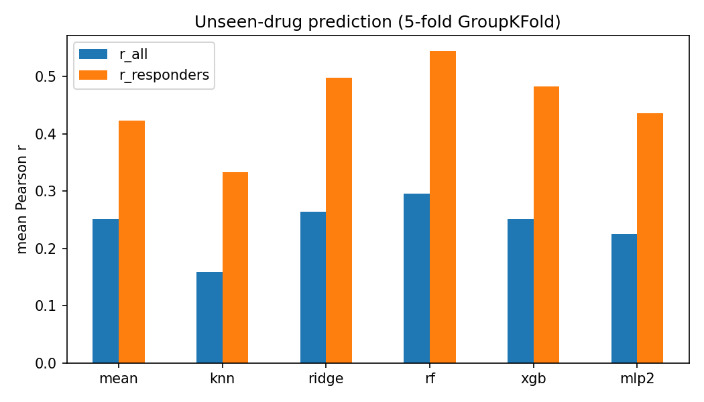
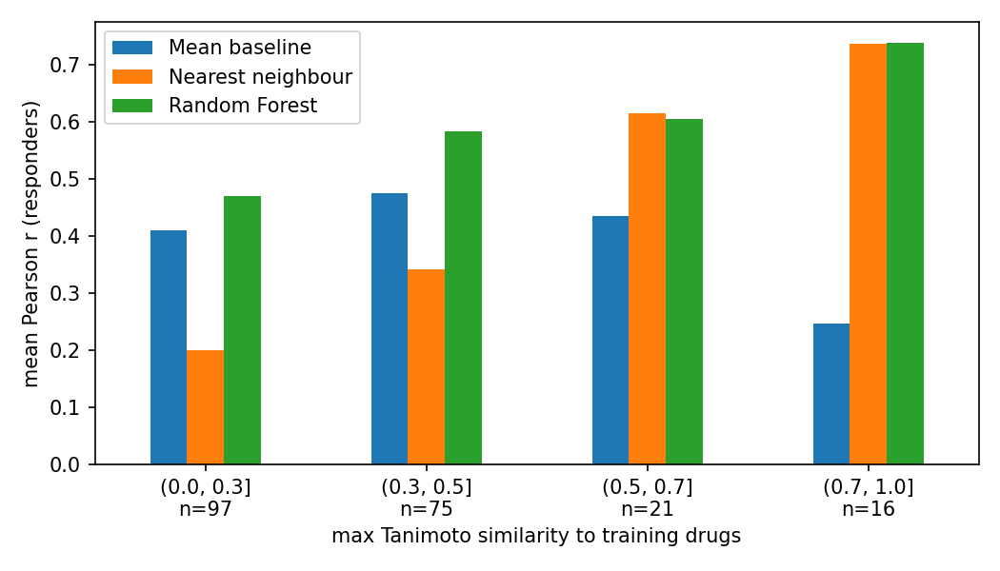
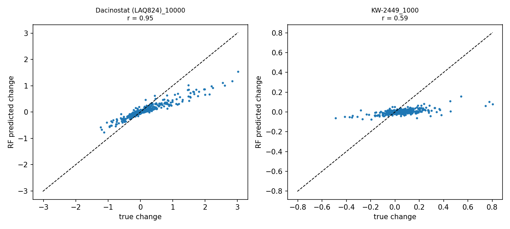

# Predicting drug responses of unseen compounds from chemical structure (sci-Plex3, A549)

Can we predict how a **new drug** changes gene expression in cancer cells, using only its **chemical structure** and **dose**?

This project uses the sci-Plex3 single-cell drug screen (Srivatsan et al., 2020) to answer that question for the A549 lung cancer cell line. Every model is tested on **drugs it has never seen**, and every result is compared to simple baselines.

---

## Main result

| Model | r (all rows) | r (responders) | MSE (responders) |
|---|---|---|---|
| Nearest neighbour (copy most similar drug) | 0.159 | 0.333 | 0.0120 |
| Mean baseline (typical drug at this dose) | 0.251 | 0.423 | 0.0105 |
| MLP v2 (small neural network) | 0.225 | 0.436 | 0.0078 |
| XGBoost | 0.251 | 0.482 | 0.0073 |
| Ridge | 0.264 | 0.498 | 0.0099 |
| **Random Forest** | **0.296** | **0.544** | **0.0074** |

*r = mean Pearson correlation between predicted and true gene changes (2,000 genes) per drug-dose. Responders = 209 of 750 drug-doses with an effect above the noise floor. All results from 5-fold GroupKFold, grouped by drug.*



**Random Forest is the best model.** It beats the mean baseline on responders (r 0.54 vs 0.42) and has about 30% lower error.

---

## Key findings

1. **Random Forest beats both baselines.** It is better than Ridge on 70% of responder rows, and Ridge is better than the mean baseline on 73%.
2. **The gain comes from non-linearity, not from PCA.** Ridge trained on the same 50 PCA components scored r 0.50, the same as plain Ridge (0.50). So Random Forest's extra gain comes from learning drug × dose interactions.
3. **Random Forest works even for drugs with no close relative in training.**

   | Max Tanimoto similarity to training drugs | Mean baseline | Nearest neighbour | Random Forest | n |
   |---|---|---|---|---|
   | ≤ 0.3 | 0.410 | 0.200 | **0.470** | 97 |
   | 0.3 – 0.5 | 0.475 | 0.342 | **0.582** | 75 |
   | 0.5 – 0.7 | 0.434 | 0.614 | 0.605 | 21 |
   | > 0.7 | 0.246 | 0.735 | **0.738** | 16 |

   Without a close relative, Random Forest still beats the mean baseline. With a close relative, it matches the nearest-neighbour approach. Accuracy rises with similarity.

   

4. **It beats the baseline at every dose**, with the largest gain at low doses (10 nM: r 0.52 vs 0.36), where only potent drugs respond.
5. **It works best for some drug classes.** Epigenetic regulators (mostly HDAC inhibitors, r 0.70) and cell-cycle drugs (r 0.64) are predicted well. Tyrosine kinase inhibitors are not (r 0.37, no gain over baseline). These are chemically diverse and have weak or varied effects in A549.
6. **Models get the direction right but underestimate the size.** For the strongest drug (Dacinostat, 10 µM) the gene pattern is almost perfect (r 0.95), but predicted changes are about half the true size. For typical responders, predictions are much smaller than the true effects.

   

7. **Neural networks and boosting did not beat Random Forest** on this small dataset (about 600 training rows per fold). The first MLP failed (r 0.23, below the mean baseline). The cause was identified (noisy PCA components weighted equally, rare fingerprint bits inflated by scaling) and fixed in MLP v2 (r 0.44). Both versions are reported.

---

## Data

- **Dataset:** sci-Plex3 (Srivatsan et al., *Science* 2020), GEO sample GSM4150378.
- **Used here:** the processed AnnData file from pertpy (`sciplex3.h5ad`).
- **Design:** 3 cancer cell lines, 188 compounds, 4 doses (10, 100, 1,000, 10,000 nM), 24 h treatment, 2 replicates, vehicle (DMSO) controls.
- **This project:** A549 only, 143,015 cells (3,287 vehicle controls).

---

## Pipeline

| Step | Notebook | What it does | Output |
|---|---|---|---|
| 1 | `01_data_inspection` | Inspect data, keep A549 cells | `a549_raw.h5ad` |
| 2 | `02_qc_normalization` | Gentle QC, normalization, replicate check | `a549_norm.h5ad` |
| 3 | `03_pseudobulk` | Sanity check, 2,000 HVGs, pseudobulk per drug-dose, subtract control, noise floor | `response_delta.csv`, `response_meta.csv` |
| 4 | `04_drug_features` | SMILES from PubChem, Morgan fingerprints, log dose, group structural twins | `X_features.csv`, `row_groups.csv` |
| 5 | `05_baselines` | Fair split (GroupKFold), mean and nearest-neighbour baselines | baseline scores |
| 6 | `06_models` | Ridge, Random Forest, XGBoost, MLP | model scores |
| 7 | `07_evaluation` | Comparison by dose, similarity, drug class; example plots | figures and tables |

### Key decisions

**Gentle QC.** A 200-gene cutoff would have removed cells mostly from cytotoxic drugs (up to 30% of one group). Large cells came partly from mitosis-blocking drugs. Since these are real drug effects, only clearly broken cells were removed (< 100 genes, 7 cells). No upper cutoff and no mitochondrial filter, because the data are nuclei.

**Replicates pooled.** Mean control profiles of the two replicates correlate at r = 0.996 with no shift.

**Two sanity checks.**
- Trametinib (MEK inhibitor) reduced the MAPK target genes DUSP6, SPRY4 and ETV5 to about 0 at all doses, as expected in KRAS-mutant A549.
- The 10 strongest responses were all HDAC inhibitors, the same result as the original paper.

**Pseudobulk.** Cells were averaged per drug-dose (groups with < 30 cells dropped: 2 groups). The response is the drug average minus the vehicle average (log fold change), giving a table of 750 drug-doses × 2,000 genes.

**Noise floor and responders.** Random groups of 100 control cells compared with the remaining controls (20 repeats) gave a maximum mean |change| of 0.0215. Drug-doses above this are responders: 209 of 750. Most drug-doses show no detectable effect.

**Drug features.** Morgan fingerprints (radius 2, 1,024 bits) after salt removal, plus log10(dose). 188 drugs gave 186 unique fingerprints: ENMD-2076 and its tartrate salt, and Ruxolitinib and S-Ruxolitinib, are identical (fingerprints ignore stereochemistry).

**Fair split.** 5-fold GroupKFold. All doses of a drug, and structural twins, are always in the same fold. No group appears in both training and test.

**PCA targets.** Random Forest, XGBoost and MLP predict 50 PCA components of the response (83% of variance), fitted inside each fold on training rows only.

**Tuning.** Ridge alpha was chosen by an inner GroupKFold on training drugs only. Random Forest, XGBoost and MLP used fixed settings (see `params.yml`), to avoid choosing settings on the test drugs.

---

## Limitations

- **One cell line (A549).** "Unseen" means a new drug in the same cell line, not a new cell line.
- **Small data.** About 186 unique drugs; results for small groups (high-similarity bins, small drug classes) are uncertain.
- **Most rows are noise.** 541 of 750 drug-doses have no detectable effect, which limits all models.
- **Gene selection used all cells.** The 2,000 HVGs were chosen using all drugs, including test drugs (as in chemCPA). Low-detection marker genes (e.g. DUSP6) are not among them.
- **Fingerprints have no 3D information** and can map different chemical pieces to the same bit.
- **Responder threshold is approximate.** It was estimated with 100-cell groups; rows with fewer cells are noisier.
- **Effect sizes are underestimated** by all models.
- **No hyperparameter tuning** for Random Forest, XGBoost or MLP.

---

## Repository structure

```
├── data/              # not in git (raw and processed data)
│   ├── raw/
│   ├── processed/
│   └── external/      # SMILES list
├── notebooks/         # 01–07 analysis notebooks
├── results/
│   ├── figures/
│   └── tables/
├── scripts/           # pipeline scripts (in progress)
├── src/               # shared helper functions
├── logs/              # notes and key numbers per step
├── params.yml         # all settings
└── environment.yml    # conda environment
```

---

## How to run

**1. Create the environment**
```bash
conda env create -f environment.yml
conda activate sciplex
```

**2. Download the data into `data/raw/`**
```bash
wget -c https://exampledata.scverse.org/pertpy/sciplex3.h5ad -P data/raw/
```

**3. Run the notebooks in order**, from `01_data_inspection` to `07_evaluation`. Step 04 needs internet access for PubChem.

A Snakemake pipeline that runs all steps with one command is in progress.

---

## References

- Srivatsan SR et al. (2020). Massively multiplex chemical transcriptomics at single-cell resolution. *Science* 367: 45–51.
- Hetzel L et al. (2022). Predicting cellular responses to novel drug perturbations at a single-cell resolution (chemCPA). *NeurIPS 2022*.
- Lotfollahi M et al. (2023). Predicting cellular responses to complex perturbations in high-throughput screens (CPA). *Molecular Systems Biology*.
- Rogers D, Hahn M (2010). Extended-connectivity fingerprints. *Journal of Chemical Information and Modeling*.
- Squair JW et al. (2021). Confronting false discoveries in single-cell differential expression. *Nature Communications*.

---

## Author

Abraham — M.Sc. Life Science Informatics, TH Deggendorf
GitHub: [pulick](https://github.com/pulick)